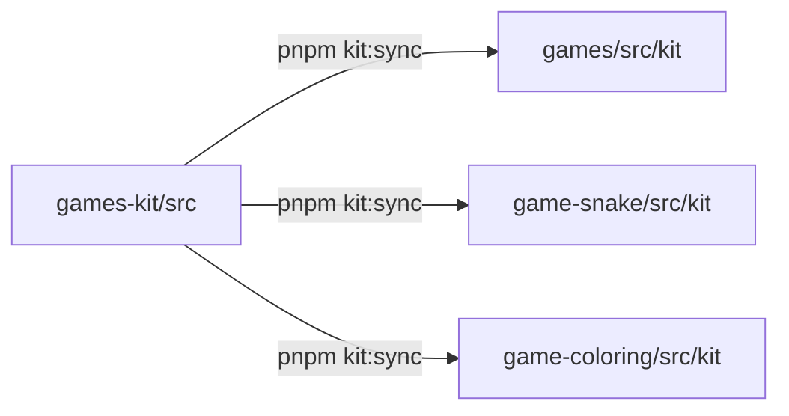
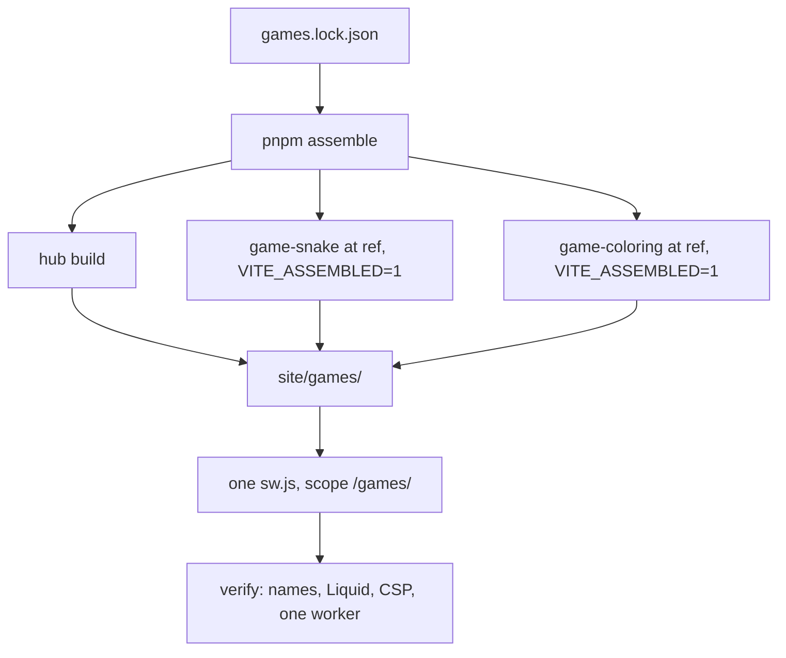

# 499apps Games: plan

This document describes the architecture, rules and roadmap of 499apps Games.
The site is at `https://499apps.com/games/`. Each game is at `https://499apps.com/games/<slug>/`.

## 1. Goals

- Make bold, glossy, toy-like 3D games for kids of all ages.
- Collect no data. Make no network calls after load.
- Work offline after the first visit, on phones, tablets and desktops.
- Keep all code open source (MIT) and clean-room.

## 2. Architecture

### 2.1 Repositories

| Repository | Folder | Contents |
| --- | --- | --- |
| `499apps/games-kit` | `games-kit/` | Shared code, config and scripts |
| `499apps/games` | `games/` | Hub, privacy page, this plan, assembly scripts |
| `499apps/game-snake` | `game-snake/` | 3D Snake (slug `snake`) |
| `499apps/game-coloring` | `game-coloring/` | 3D Coloring (slug `coloring`) |

Keep the repositories as sibling folders in one workspace folder.

### 2.2 Vendored kit

Each consumer repo holds a copy of the kit in `src/kit/`.

1. Change the kit in `games-kit/` and commit it.
2. In each consumer, run `pnpm kit:sync`.
3. The script copies `../games-kit/src` to `src/kit/` and writes the kit sha to `kit.lock`.
4. Commit `src/kit/` and `kit.lock` in the consumer.

Result: every repo builds alone from a fresh clone. No package registry is necessary.



### 2.3 Assembly

`pnpm assemble` (in `games/`) makes one drop-in folder, `site/games/`.

1. Build the hub into `site/games/`.
2. Read `games.lock.json`. Each entry has `slug`, `repo` and `ref`.
3. For each game, clone the pinned ref. Use the sibling folder `../game-<slug>` when it exists, else GitHub.
   The clone holds committed files only. Uncommitted changes never ship.
4. Install, then build with `VITE_ASSEMBLED=1`. Copy `dist/` to `site/games/<slug>/`.
5. Write one service worker, `site/games/sw.js`, with scope `/games/`.
6. Verify the output (see 2.5).

`pnpm assemble:lock` sets each `ref` to the current `HEAD` of the sibling folder.



### 2.4 Service workers and manifests

| Build | Worker it registers | Scope | Manifest |
| --- | --- | --- | --- |
| Hub (always) | `/games/sw.js` | `/games/` | `/games/manifest.webmanifest` |
| Game, standalone | `/games/<slug>/sw.js` | `/games/<slug>/` | `/games/<slug>/manifest.webmanifest` |
| Game, assembled | `/games/sw.js` | `/games/` | `/games/manifest.webmanifest` |

- The worker is hand-written. A build script fills the precache list and a content-hash version.
- The worker serves precached files cache-first. It caches nothing else.
- A new version installs, calls `skipWaiting`, and controls the next page load.
- An assembled game unregisters any old worker with the scope `/games/<slug>/`.

### 2.5 Publishing (no GitHub Actions)

The 499apps.com site is a GitHub Pages repo with the legacy Jekyll build and no `.nojekyll`.

1. In `games/`, run `pnpm ci:site`. It assembles the site and runs the smoke suite on it.
2. Copy `site/games/` into the 499apps.com repo as `games/`.
3. Open a pull request in the 499apps.com repo. Review it, then merge it.

The assembly verifies these Jekyll rules:

- No file or folder name starts with `_` or `.`. Jekyll skips those names.
- No HTML file starts with front matter (`---`).
- No HTML file contains `{{` or `{%`. Liquid would change them.
- No `CNAME` file.

CAUTION: Do not add a `.github/workflows` folder to any repo. All CI is local.

## 3. Stack

- Vite, TypeScript (strict), three.js from npm (bundled, never from a CDN).
- pnpm. Node 20.19 or later.
- Vitest (pool `threads`) and fast-check for unit and property tests.
- Playwright for smoke tests: desktop Chromium, Firefox, WebKit, iPhone and Pixel emulation.
- ESLint (flat config, typescript-eslint) and Prettier, shared from the kit.

## 4. Privacy model

- No accounts, ads, analytics, cookies, trackers, fingerprinting or external links.
- No `fetch`, XHR, WebSocket or beacon after load. The service worker precache is the only network use.
- Every page has the same Content-Security-Policy meta tag and `referrer: no-referrer`.
- No inline scripts. No `'unsafe-eval'`.
- Storage is `localStorage` only. Every key starts with `g499:`.
- "Clear my data" removes every `g499:` key and any user-data cache. It is on the hub (left rail) and on the privacy page. It needs a long hold, so a child cannot press it by accident.
- Fonts come from the system font stack. Sounds come from WebAudio synthesis. Icons are original code-drawn art.
- The CSP meta tag has no `frame-ancestors` directive, on purpose. Browsers ignore `frame-ancestors` in a meta tag, and Chromium logs a console error for it. The smoke suite fails on any console error. To block framing, the host must send `frame-ancestors 'none'` as an HTTP header. GitHub Pages cannot send custom headers, so this is not possible today. Do not add the directive to the meta tag.

### 4.1 Storage keys

| Key | Owner | Contents |
| --- | --- | --- |
| `g499:mute` | kit | Sound on or off |
| `g499:snake:*` | game-snake | Best score per mode (`best:easy`, `best:normal`, `best:fast`; garden boards add `:garden`), mode, d-pad on or off, garden boards on or off |
| `g499:coloring:*` | game-coloring | Saved pictures, settings |

## 5. Offline model

1. The first visit registers the worker. The worker downloads every file in the precache list.
2. The worker takes control of the page.
3. Later visits load every page and game from the cache, also in airplane mode.
4. A new deploy changes the content hash. The new worker installs and controls the next load.

The smoke suite checks this: it activates the worker, sets the browser offline, and reloads each page.

## 6. Licensing and clean-room policy

- Implement public game mechanics from scratch. Do not read or copy other implementations.
- Do not copy ROMs, sprites, sounds, music or level data.
- Do not use trademarked names, logos or trade dress. Use generic names: "Block Drop", not the trademark.
- Do not use real company marks or likenesses (no space-company or car-company logos).
- Third-party code: MIT, CC0, OFL or Apache-2.0 only. Assets: CC0 or MIT only.
- List every bundled package and asset in `LICENSES.md`.
- Project code: MIT, Copyright (c) 2026 499apps.

## 7. Design rule: menus on the left

This is a global rule from the owner.

- All menus go on the left side.
- Tablet and desktop: a fixed left rail.
- Phone (width below 720 px): a left slide-out drawer. A button at the top-left corner opens it, on every page (hub, privacy page and games). Game controls on the left start below this button.
- Rail labels are short ("Sound", "Full screen", "Clear data") and wrap to 2 lines at most. They are never cut off.
- The rail holds: home, game actions (for example restart or mode), mute, fullscreen (where supported), privacy link, "clear my data".
- Never put menus or settings buttons top-right or on the right side.
- HUD readouts (score, best) can go where gameplay needs them.
- The smoke suite checks that the menu box starts left of one third of the viewport width.

```text
+------+-------------------------------+
| rail |                         [HUD] |
| home |                               |
| mute |          play area            |
| full |                               |
| priv |                               |
| clear|                               |
+------+-------------------------------+
 desktop / tablet

+-------------------------+
|[=]               [HUD]  |   [=] = top-left drawer button
|                         |
|       play area         |
|                         |
+-------------------------+
 phone (drawer closed)
```

## 8. Phones are first-class

- Installable PWA: manifest (standalone, theme and background colour, maskable 192 and 512 icons).
- iOS tags: `apple-touch-icon` (180 px), `apple-mobile-web-app-capable`, status-bar style, title, `theme-color`, `viewport-fit=cover`.
- Touch targets are 56 px or larger. On-screen controls where a game needs them.
- The rail, drawer and HUD respect `env(safe-area-inset-*)`.
- Game pages block pinch-zoom, double-tap zoom, text selection, long-press callouts and scroll bounce.
  The hub and privacy page keep zoom for accessibility.
- Portrait and landscape layouts. The hub uses one shelf in landscape and two columns in portrait.
- Fullscreen toggle in the rail where the Fullscreen API exists. It is hidden where it does not (iPhone Safari).
- Capacitor-friendly code: base-aware URLs, no server features, state in `localStorage`, no `window.open`.

## 9. Visual direction

Look: a modern arcade cabinet in a cozy playroom. Bold, glossy, toy-like.

### 9.1 Palette (`games-kit/src/theme.ts`)

| Name | Hex | Use |
| --- | --- | --- |
| night | `#1b1740` | Background, theme colour |
| plum | `#2d2259` | Floors, panels |
| ink | `#17132b` | Dark details |
| coral | `#ff6b6b` | Accent |
| tangerine | `#ffa94d` | Accent, warm glow |
| lemon | `#ffe66d` | Highlights, focus ring |
| lime | `#8ce99a` | Success, hub Snake tile |
| mint | `#63e6be` | Accent |
| sky | `#74c0fc` | Coloring, cool accent |
| lavender | `#b197fc` | Accent |
| bubblegum | `#f783ac` | "Clear my data", accent |
| cream | `#fff7e6` | Text |

Game-local colours (not in the kit palette): the Snake body is a stronger green, `#2fc45a` with `#178a45` bands (`game-snake/src/scene.ts`), because the pastel lime read near-white under bloom. The Snake gem food is `#3d8bfd`.

### 9.2 Lighting recipe

- Hemisphere light: sky `#d6e9ff`, ground `#4a3a7a`.
- Key light: warm `#fff1dc`, intensity 2.4, from top-right front. It casts soft PCF shadows.
- Rim light: cool `#8ec5ff`, from behind-left.
- Fill light: pink point light `#ffb8d1`, intensity 14, front-left.
- Environment: `RoomEnvironment` through PMREM, made locally. No HDR downloads.
- Materials: `MeshPhysicalMaterial` with clearcoat for candy plastic. Sheen is off by default (it adds a white rim and costs GPU time).
- Post: UnrealBloom (strength 0.4, radius 0.45, threshold 1.0), vignette, ACES Filmic tone mapping (exposure 0.95), sRGB output. Pages can set their own bloom and tone mapping: the hub uses threshold 1.15, Coloring uses Neutral tone mapping so paints match their swatches.
- Look gate: lit pastel surfaces must not clip to white. The smoke suite opens each 3D page at `?tier=high` (bloom on) and checks that less than 3% of the canvas has min(R, G, B) of 240 or more. A page can leave out a rectangle that is white on purpose (the Coloring paper).
- Motion: squash and stretch, eased lifts, particle pops, gentle idle bobbing.

## 10. Performance budget

- Target: 60 fps on a mid-range phone.
- Device pixel ratio cap: 2 (high), 1.5 (medium), 1 (low).
- Quality tiers: shadows, shadow map size, bloom and particle count per tier.
- A startup probe picks the first tier. A frame-time monitor lowers the tier when the median frame time of a 30-frame window is above 20 ms (about 1 s at 30 fps).
- On a software rasteriser (SwiftShader, llvmpipe, Microsoft Basic Render Driver), the first tier is `low`. `?tier=` overrides this.
- Test mode (`?test=1`) draws frames on demand: once at start, then after a step, an input, a resize or a tier change. `&live=1` keeps the continuous loop.
- Test mode creates no AudioContext. Audio errors never throw and never log to the console.
- Pause the loop on `visibilitychange`. Dispose GPU resources on page exit.
- Smoke test: median frame time 20 ms or less in desktop Chromium.
  Headless allowance: on a software rasteriser (SwiftShader) the test starts at the low tier and allows 50 ms.
  Set `E2E_FPS_BUDGET_MS` to change the budget.
- The frame-time test and the host-GPU look gate run alone, after the parallel shards, with one worker (`run-e2e.mjs`, tests whose title holds "frame-time budget"). Measure on a quiet GPU: close other Playwright runs, and turn off screen savers and other GPU users on the host. A failure in the 2026-10-30 review run came from another project's Playwright run and a screen saver that shared the GPU. The budget stays at 20 ms.

## 11. Accessibility

- Every 3D tile also has a real `<a>` link with an `aria-label`. Links are keyboard-focusable.
- Visible focus ring (lemon, 3 px).
- Playable with no reading: icons, colours and motion cues. Short labels are extras.
- `prefers-reduced-motion`: less camera motion, fewer particles, no bloom pulsing. The game stays playable.
- Sound is calm and short. One mute toggle for all games, kept in `g499:mute`.
- Keyboard, touch, mouse and gamepad (Gamepad API) map to the same actions.

## 12. Quality bar and testing

"Exceptional, not novice" for every page: art-directed light, polished transitions, good game feel, no jank.

| Check | Tool | Where |
| --- | --- | --- |
| Types | `tsc --noEmit` | every repo |
| Lint | ESLint | every repo |
| Unit and property tests | Vitest + fast-check | game rules, storage, input, precache, layout, lock |
| Secrets, user paths, e-mail addresses | `pnpm scan:secrets` | every repo |
| Smoke and visual | Playwright, 5 projects | every page and game |

`pnpm ci:local` runs typecheck, lint, unit tests and `scan:secrets` in parallel. Then it builds. Then it runs the Playwright suite in shards (`E2E_SHARDS`, default 2). It prints test counts and wall-clock time.
Workers per shard: `max(1, floor(cpus × 0.25 / shards))`, because software WebGL uses much CPU. Set `E2E_WORKERS` to change it.

The smoke suite checks, for each page:

1. The page loads with no console errors. The WebGL canvas shows a real picture.
2. No request goes to another host. No cookie exists.
3. A scripted round plays: keyboard on desktop, tap and swipe on phones.
4. The left menu opens and closes, and it is on the left.
5. The manifest is valid and linked. The service worker controls the page.
6. After the worker is active, the page reloads offline and still renders.
7. Frame-time budget (desktop Chromium).
8. Look gate at `?tier=high`: less than 3% clipped-white pixels (desktop Chromium, software GL in the shards, the host GPU in the frame-time pass).
9. A visual baseline matches (seeded RNG, frozen clock with `?test=1`).

Engines without WebGL on the host mark only the pixel check as `fixme`, with the reason.
Visual baselines are in `e2e/screenshots/<project>-<platform>/`. A missing baseline is written on the first run.

## 13. Game roadmap

Effort: S = about 1 week, M = 2 to 3 weeks, L = 4 weeks or more.

### Phase 1 (now)

| Game | Repo | Status |
| --- | --- | --- |
| Hub | `499apps/games` | Built |
| 3D Coloring | `499apps/game-coloring` | Built (G3): picture picker, fill, brush and rainbow tools, undo, autosave, PNG export |
| 3D Snake | `499apps/game-snake` | Built (G2): easy, normal and fast modes |

### Next: Catch the Booster

- Repo: `499apps/game-catch-the-booster`. Hub tile: "coming soon" (disabled).
- Original design. No space-company names (the game is "Catch the Booster", never a real vehicle name), no logos, no trade dress and no exact likenesses of real rockets, towers or launch sites.
- Mechanic: a returning rocket booster descends with wind drift. The player slides the tower arm carriage and closes two padded catcher arms at the right time to catch it.
- Descent: throttle bursts, gusts, a landing-burn window.
- Scoring: softness of the catch and centring between the arms.
- Miss: the booster bounces gently on a soft pad. No explosions.
- Controls: drag or arrow keys slide the carriage; tap, Space or the A button closes the arms.
- Kid-safe twist: a slow-motion "help" mode and a friendly ground crew that cheers.
- 3D look: highly realistic and very polished: dusk lighting, heat shimmer, volumetric exhaust glow, detailed tower lattice.
- Effort: L. The full design doc comes later as `docs/catch-the-booster.md`. Do not build it in this phase.

### Next: Flip the Roadster

- Repo: `499apps/game-flip-the-roadster`.
- Original design: a generic, cute electric roadster. No car-company marks or likeness.
- Mechanic: side-view 3D stunt racer over rolling hills and ramps.
- Controls: hold to accelerate; in the air, lean or flip (left and right, or tilt).
- Land on the wheels for a speed boost. Chain flips for trick combos. Checkpoints.
- Kid-safe twist: no damage. A bad landing gives a wobbly bounce. Optional low-gravity moon level.
- 3D look: candy car with clearcoat paint, soft-shadow hills, dust puffs, sunset sky.
- Effort: M.

### Retro-mechanic games (generic names, original code and art)

| Game | Mechanic | Controls | Kid-safe twist | 3D look | Effort |
| --- | --- | --- | --- | --- | --- |
| Block Drop | Falling-blocks puzzle: fill rows to clear them | Swipe or arrows to move, tap to turn | Slow start, no fail screen; a full board gently resets | Glossy jelly blocks on a toy shelf | M |
| Brick Bop | Paddle and ball break a wall of bricks | Drag or arrows | Wide paddle option; the ball never "dies", it floats back | Candy bricks that pop into confetti | M |
| Paddle Pals | Two-paddle ball game | Drag, arrows, or two players on one screen | Friendly AI that matches the child's level | Table-top arena with soft lights | S |
| Copy Colors | Repeat a growing colour-and-sound sequence | Tap the pads, keys 1-4, gamepad face buttons | Replay the hint any time; mistakes just replay | Four glowing dome buttons | S |
| Memory Match | Flip cards to find pairs | Tap or arrows and Enter | Small grids first; peek button | Chunky tiles that flip with a squash | S |
| Flower Field | Grid of covered tiles; numbers show nearby flowers. Find all flowers (no mines, no bombs) | Tap to open, long-press or X to mark | Opening a flower tile shows a happy bloom, not a loss; hints | Garden plot with grass tiles and blooming flowers | M |
| Maze Mouse | Guide a mouse through a 3D maze to the cheese | Swipe or arrows | No timer; a glowing trail shows the path back | Wooden toy maze, tilt camera | S |
| Tower Stack | Drop sliding blocks to build a tall tower | Tap or Space | Slices are soft; the tower wobbles but does not fall | Pastel blocks, sky gets darker and starry as it grows | S |
| Rhythm Tapper | Tap notes in time with a synthesised tune | Tap lanes, keys D F J K | Wide timing window; no "miss" sound, only nice notes | Glowing lanes on a toy stage | M |

## 14. Status and next steps

- G1 (this task): kit, hub, privacy page, assembly, local CI, game scaffolds, this plan.
- G2 (done): the full 3D Snake in `game-snake`.
- G3 (done): the full 3D Coloring in `game-coloring`.
- Later: Catch the Booster design doc, then the game.
